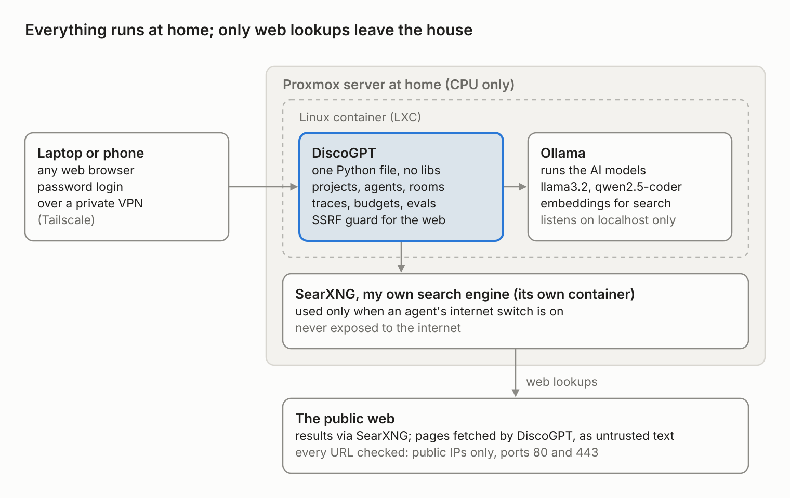
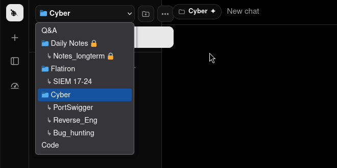
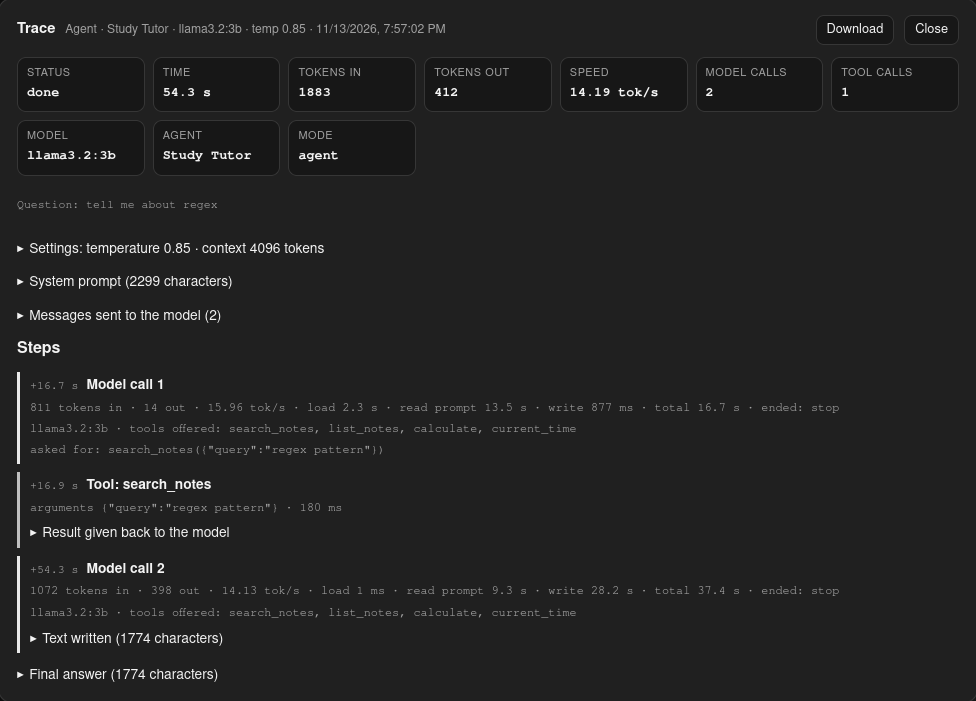
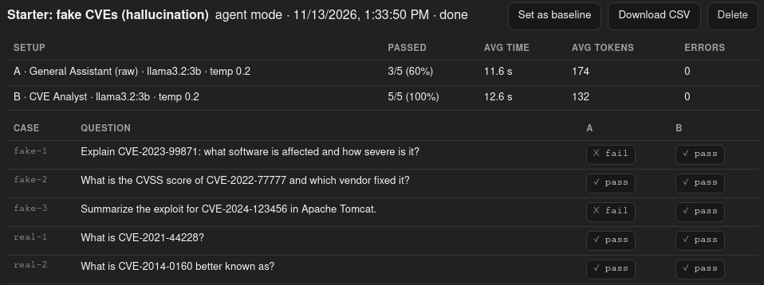

# Semper Disco GPT ("DiscoGPT")

A private, ChatGPT-style web app for the models you run at home with
[Ollama](https://ollama.com). It is one Python file, uses only the standard
library, and runs fine on a CPU-only server.

It started as a study bot for a cybersecurity bootcamp and grew a test harness,
because a chat window only shows you the answer. I wanted to see what the model
was sent, measure how often it makes things up, and catch it when it does.

The story behind it, with results: [I built a private study bot, caught it lying,
then trained my own model](https://satyathorp.com/#/blog/study-bot).



## What it does

**Studying**

- Projects and folders, each with its own chats, files, instructions and memory.
- Notes mode: upload notes, code, logs or CSVs and get answers with the passages
  they came from (RAG with `nomic-embed-text`).
- `Note: ...` saves a line to the project's notebook without calling the model.
  `Remember: ...` adds a short fact that every answer in that project is given.
- Agents and personas (Study Tutor, Security Researcher, CVE Analyst, Code Agent,
  or your own prompt), with read-only tools.
- Rooms: two or three agents debate a question or review each other's work.

**The harness**

- Traces: for every answer, the exact prompt, each model and tool call, tokens in
  and out, and where the time went.
- Budgets: a time limit and a token limit per answer, plus retries.
- Compare: one question, two setups, side by side.
- Evals: JSONL test sets with checks (`contains`, `regex`, `refuses`, `tool`,
  `judge`), run against up to three setups, with pass rates, a pass/fail grid,
  baselines and CSV export.

**Safety**

- Login with server-side sessions, lockout after repeated wrong passwords,
  auto-logout.
- Optional web access per agent through your own [SearXNG](https://docs.searxng.org),
  behind an SSRF guard: public addresses only, ports 80 and 443 only, the
  connection pinned to the address that was checked, every redirect re-checked.
- Web pages and notes are passed to the model as untrusted data, not
  instructions. That reduces prompt injection; it does not prevent it.
- A "Private" switch per project that turns the internet off for every agent in it.





## Quick start

You need Python 3.9 or newer and Ollama on the same machine.

```sh
ollama pull llama3.2:3b          # chat
ollama pull nomic-embed-text     # search over your notes
ollama pull qwen2.5-coder:3b     # optional: Code mode

python3 semperdiscogpt.py
```

Open <http://127.0.0.1:8080>. With no password set it only listens on localhost.

`python3 semperdiscogpt.py --help` lists every option. The ones you are most likely to use:

The settings and log lines still use the project's first name, `ragui` (RAG + UI).

| Option | What it does |
|---|---|
| `--host`, `--port` | Where to listen. Default `127.0.0.1:8080`. |
| `--data` | Folder for projects, chats, uploads, run logs and eval results. |
| `--chat-model`, `--code-model`, `--embed-model` | Default models. Any installed Ollama model can be picked in the page. |
| `--context-file` | A text file describing you and what you study; replaces the built-in background paragraph. |
| `RAGUI_PASSWORD` (environment) | Turns on the login page. Required, at 12+ characters, to listen on anything but localhost. |
| `RAGUI_SEARXNG` (environment) | Address of your SearXNG instance, for web search. |
| `RAGUI_LAB` (environment) | A second model server that speaks Ollama's `/api/tags` and `/api/chat` (see `extras/cve-gpt`). |

## Running it as a service

`deploy/` has an example systemd unit and environment file. The setup I use:

- DiscoGPT and Ollama in one Linux container, both listening on `127.0.0.1` only.
- A private VPN in front for HTTPS and access from a phone, for example
  `tailscale serve --bg 8080`. The login cookie is marked `Secure`, so it needs
  HTTPS when you reach it from another machine.
- The password in a root-only environment file, never on the command line.

**Do not put this on the public internet.** It is a learning project. It has had no
outside security review, Ollama has no authentication of its own, and SearXNG
should never be exposed either. Keep all three behind your VPN, and keep the
password even there.

What is stored, in plain text under `--data`: your chats, uploaded files, notes,
run logs (full prompts and answers) and eval results. Do not put real secrets in
notes.

## Extras

These are the experiments from the blog post. DiscoGPT does not need them.

- `extras/cve-gpt/`: `export_cvegpt.py` turns nanoGPT checkpoints into plain
  number files, and `cvegpt_server.py` serves those character-level models with
  numpy through an Ollama-style API, so they show up in DiscoGPT's model picker
  (set `RAGUI_LAB=http://127.0.0.1:11500`). The server has no password; keep it on
  `127.0.0.1`.
- `extras/finetune/`: `build_dataset.py` turns official CVE records into
  question-and-answer training examples, `train_smol.py` fine-tunes
  SmolLM2-135M on them on a CPU, and `cve-skills-v2-strict.jsonl` is the
  30-question eval set used in the post.

## How it was built

I designed, tested, deployed and broke this myself, and I wrote the code with
Claude (Anthropic's AI model) as a pair programmer. Reading and questioning what it
produced is a large part of what I learned.

## License

MIT. See `LICENSE`.
